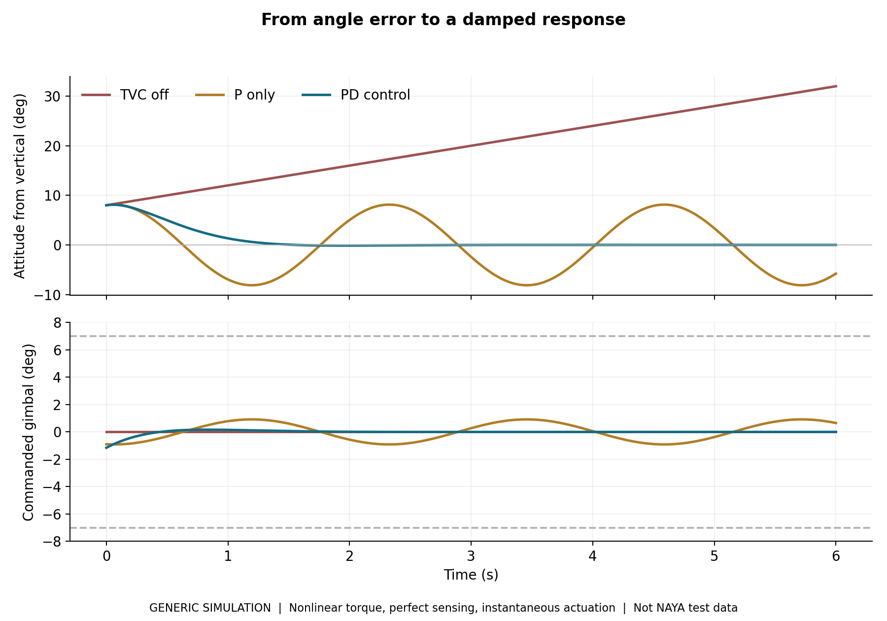

# TVC Simulation Starter

**A friendly introduction to thrust vector control, inspired by Project: NAYA.**  
James Bourke | First-pass educational pack | 2026



## What this is about

Project: NAYA was my university capstone project at Deakin University, where I explored thrust vector control (TVC) using a bench demonstrator. This pack takes a step back from that project and shares the basic maths and simulation ideas behind attitude control. Hopefully it gives other students and hobby rocketry enthusiasts a useful place to start.

The idea is simple: if a rocket starts leaning, can we steer its thrust to bring the angle back towards vertical without making it wobble forever?

Everything numerical here is a **fresh, generic example**. These are not NAYA's controller gains, dimensions, test logs, identification results or final models. This pack does not explain NAYA's hardware, wiring, mechanisms, calibration or implementation. No thesis pages, university templates or private photographs are bundled.

## What you get

| File or folder | What it does |
|---|---|
| `QUICKSTART.txt` | The short version: open MATLAB and get started |
| `matlab/tvc_parameters.m` | Editable, made-up example parameters |
| `matlab/tvc_gains.m` | Calculates starting values for Kp and Kd |
| `matlab/run_demo.m` | Runs the attitude and hypothetical flight comparisons |
| `simulink/tvc_pd_educational.mdl` | Readable Simulink model of a linear attitude loop |
| `matlab/build_simulink_model.m` | Builds the same loop as a native `.slx` file on your machine |
| `docs/CONTROLS_WALKTHROUGH.md` | Equations, signs, units and gain calculation |
| `docs/FLIGHT_RESULTS.md` | What the comparison means for the toy flight |
| `docs/TRY_IT_YOURSELF.md` | A few useful tuning exercises |
| `verification/` | Independent Python reproduction and numerical checks |
| `results/` and `figures/` | Computed generic example outputs |

## Start here

Unzip the pack, then set MATLAB's Current Folder to `TVC-Simulation-Starter`:

```matlab
addpath('matlab');
check_demo;
results = run_demo;
```

`run_demo` leaves an editable `p` parameter structure in the base workspace and writes new MATLAB outputs to `results/matlab_run/`. The bundled reference figures and CSVs stay separate from your runs.

To open the supplied Simulink model:

```matlab
p = tvc_parameters();
addpath('simulink');
open_system('tvc_pd_educational');
check_simulink;
```

Or generate a native SLX version with standard Simulink blocks:

```matlab
build_simulink_model;
check_simulink('tvc_pd_generated');
```

**Requirements:** MATLAB for the `.m` simulations; MATLAB plus Simulink for the block model. No Control System Toolbox, Aerospace Blockset or Simscape is used. The source aims for R2020b or later, but release compatibility has not been runtime-tested. The optional Python reproduction needs NumPy, SciPy and Matplotlib.

## The controller in one minute

We start with one rotational axis and a deliberately simple plant:

$$\ddot{\theta}=b\delta,\qquad b=\frac{T\ell}{I}.$$

Here, theta is tilt from vertical, delta is a signed mathematical gimbal command, T is thrust, ell is its moment arm and I is rotational inertia. The goal is zero tilt:

$$\delta=-K_p\theta-K_d\dot{\theta}.$$

Kp pulls the angle back towards the target. Kd provides damping using angular rate. Matching the closed-loop equation to a standard second-order response gives:

$$K_p=\frac{\omega_n^2}{b},\qquad K_d=\frac{2\zeta\omega_n}{b}.$$

The script uses the approximate design relation $\omega_n=4/(\zeta T_s)$ to calculate a starting point. It then measures the simulated response rather than assuming the target has been achieved. See the walkthrough for the assumptions behind this shortcut.

**All controller angles are in radians.** Plots convert them to degrees for readability. The code calculates a PD controller; it does not hide a NAYA gain set or include an integral term.

## What changes in the flight example?


There are four cases: an ideal vertical reference, TVC off, P control and PD control. The three disturbed cases start with the same tilt and angular rate. They use the same assumed mass, thrust, drag and burn duration.

The uncontrolled example keeps rotating during the burn because no corrective torque acts. P control brings the angle back but continues oscillating. PD control damps that motion, so more of the thrust stays usefully aligned with the intended vertical direction. It also spends less time accelerating sideways.

The independently computed reference example reaches about **65.33 m with TVC off** and **74.39 m with PD**, against a **74.83 m ideal vertical reference**. Those are hypothetical simulation outputs, not NAYA flight results or a promise of a real altitude improvement. The explanation and comparison table are in [the flight notes](docs/FLIGHT_RESULTS.md).

## Know the model's boundaries

This is one axis in a plane. It assumes constant mass, a fixed inertia, constant powered thrust, perfect angle/rate feedback and instantaneous actuation with a command-angle limit. The flight extension adds gravity and a simple drag force, but no wind, aerodynamic moments, launch rail, changing centre of mass, actuator lag, sensor noise or cross-axis coupling. The attitude-only exercise keeps thrust available for its full six-second window; the separate flight exercise stops thrust at four seconds.

The Simulink model uses **linear torque** ($b\delta$). The MATLAB demo and Python reference use **nonlinear torque** ($b\sin\delta$). `check_simulink` deliberately compares Simulink with the linear MATLAB option. Neither is a validated flight controller or a hardware operating guide.

The original NAYA project was a bench demonstrator. It did not establish a free-flight altitude benefit. This pack uses a separate hypothetical flight scenario to make the control concept easier to see.

## Verification status

- **Executed here:** independent Python simulation, comparison with the analytical linear response, stable-pole and command-limit checks, uncontrolled-motion check, and zero-disturbance flight equivalence.
- **Included for you to execute:** MATLAB `check_demo` and Simulink `check_simulink`.
- **Not executed here:** MATLAB, Simulink, `.mdl` loading or `.slx` generation; those runtimes were unavailable. The `.mdl` is hand-authored and remains unverified by Simulink. The SLX builder is an alternative construction route, not evidence of a completed Simulink run.

See [verification notes](docs/VERIFICATION.md) for reproduction commands and limits.

## Credit and reuse

Copyright (c) 2026 James Bourke, for original material in which he owns the rights. Code and model files use the [MIT licence](LICENSE). Original documentation, figures and numeric result tables use [CC BY 4.0](LICENSE-DOCS.md), matching the earlier CFD pack's licence split. Please retain the required notices, credit the work and identify changes as the applicable licence requires. These licences permit commercial reuse; they do not make the material exclusive.

This is an independent educational extension of a university project, with AI assistance used in preparing code and explanatory material. It is not endorsed by Deakin University, MathWorks or an employer. Third-party rights and the project name are not transferred by these licences. See [NOTICE.md](NOTICE.md) for scope and [technical references](docs/SOURCES.md) for further reading.
