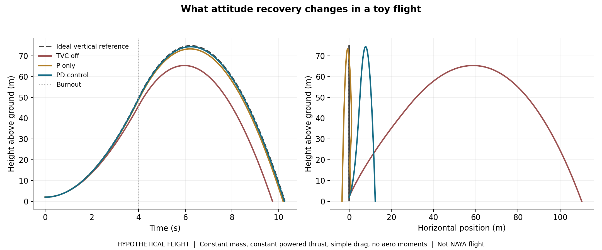

# What better attitude control changes in the toy flight

A tidy angle plot is useful, but it helps to connect it to the bigger picture. Here we ask a separate question: if the body recovers towards vertical during a hypothetical powered flight, what changes in the resulting trajectory?

This is a newly constructed teaching example. Project: NAYA was a university bench demonstrator, and these curves are not its flight path, a reconstruction of its tests or evidence that it flew.

## Keep the comparison fair

TVC off, P and PD all start with an 8 degree tilt and a 4 degree/s angular rate. Their assumed mass, thrust, drag, moment arm, inertia and four-second burn are identical. The ideal reference starts vertical with zero angular rate, so it is a reference rather than a fourth disturbed-controller trial.

The vehicle starts at a hypothetical height of 2 m with zero translational speed. There is no rail or ground constraint; it is already a free body. The attitude-only plot uses a six-second powered window, while this flight model cuts thrust at four seconds and coasts until ground contact or 20 s.

## Add translation to the attitude equations

Positive delta produces positive angular acceleration. For a thrust force applied below the centre of mass in the chosen planar sign convention, the absolute thrust direction is

$$\alpha=\theta-\delta.$$

That sign matters: a correcting moment can briefly tilt the thrust force farther from vertical even while it rotates the body back. We include that cost rather than pretending all thrust is instantly vertical.

With horizontal velocity vx, vertical velocity vz and speed $v=\sqrt{v_x^2+v_z^2}$:

$$m\ddot{x}=T\sin\alpha-\tfrac12\rho(C_DA)vv_x,$$
$$m\ddot{z}=T\cos\alpha-mg-\tfrac12\rho(C_DA)vv_z.$$

The angular equation is $I\ddot\theta=T\ell\sin\delta$. At burnout, T becomes zero, so there is no further control torque in this model. Angular rate then remains constant because no aerodynamic moment is included. Gravity continues acting during coast.

## Computed reference results

These values came from the independent Python execution supplied in `verification/`. MATLAB implements the same equations and writes its own outputs when run locally. Small solver and output-sampling differences are expected.

| Case | Height at burnout | Approximate apogee | Attitude-only 2% settling |
|---|---:|---:|---:|
| Ideal vertical reference | 49.64 m | 74.83 m | Already at target |
| TVC off | 45.89 m | 65.33 m | Not reached within 6 s |
| P only | 48.87 m | 73.33 m | Not reached within 6 s |
| PD control | 49.35 m | 74.39 m | 1.42 s |

Apogee is the maximum of the saved 0.01 s height samples, so it is a sampled estimate. Settling means the angle enters and stays inside ±0.16 degrees, which is 2% of the initial 8 degrees, for the rest of the attitude simulation. It does not also impose an angular-rate requirement.

## What to take away

With TVC off, the initial rate keeps increasing the tilt during the burn. More thrust goes sideways and less remains available for upward acceleration. P control improves alignment, but the undamped rotational model keeps oscillating. PD control removes most of that sustained angular motion, keeping the trajectory closer to the ideal reference.

In this selected example, the PD case reaches roughly 9.06 m higher than TVC off. That is an illustration of thrust-direction management, not a transferable performance claim. Different initial conditions, slower actuation, model errors or aggressive gains can reduce or reverse the advantage. If the body starts perfectly vertical with no angular rate, the ideal model needs no correction and PD matches the vertical reference.

## What this cannot tell you

This is not a complete rocket performance model. There is no mass depletion, thrust curve, wind, aerodynamic restoring or destabilising moment, flexible structure, cross-axis coupling, sensor error or actuator delay. CdA is a fixed lumped drag assumption; it does not vary with angle or speed. There is no mass or power penalty for adding TVC. Translational drag acts through the centre of mass and cannot damp the attitude here.

The comparison demonstrates a mechanism: controlling orientation can preserve useful thrust direction. It does not validate an airframe, predict NAYA's altitude or establish that TVC improves every hobby rocket.
